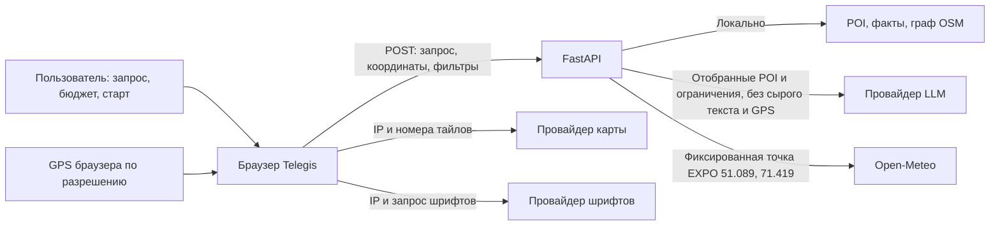

# Telegis: какие данные куда передаются

Telegis получает выбранную стартовую точку либо координаты, которые пользователь разрешил браузеру определить. Сервер использует их для поиска и расчёта пути. Утверждение «GPS не отправляется модели» не означает, что координаты вообще не покидают браузер.

| Поток | Передаваемые сведения | Хранение и оговорки |
|---|---|---|
| Браузер → Telegis | Текст запроса, выбранные координаты, категория, бюджет и переключатели. | Приложение обрабатывает их в памяти. Собственной базы пользователей и истории GPS нет. API отвечает с `Cache-Control: no-store`. |
| Telegis → LLM | ID и названия отобранных мест, описания, допустимые причины/занятия, нормализованные ограничения. | Исходный запрос и координаты пользователя исключены из модельного контекста. Список POI всё равно раскрывает примерный район поиска. Действуют правила хранения провайдера. |
| Telegis → Open-Meteo | Постоянная точка района EXPO: 51.089° N, 71.419° E, перечень погодных переменных. | GPS пользователя не подставляется. Провайдер видит запрос и IP сервера. В памяти Telegis кэшируется общий погодный ответ, а не пользовательская история. |
| Браузер → тайлы карты | Адреса тайлов видимой области, IP браузера и обычные сетевые заголовки. | Область карты может косвенно раскрывать интересующее место. Правила хранения определяет внешний сервис. |
| Браузер → шрифты | Запрос файлов шрифтов, IP и сетевые заголовки. | Внешние ресурсы не дают оснований обещать абсолютную анонимность. |
| Пользователь → ссылка на источник | Страница OSM, официальный сайт либо иной адрес после явного перехода. | Дальше применяются правила внешнего сайта. Telegis не контролирует его журналы или cookies. |

## Локальные данные

В Git включены публичные POI, снимки OSM и короткие фактические выдержки официальных страниц. Это данные объектов, а не история пользователей. Пешеходный граф и кэш путей опираются на публичные узлы OSM. Сборщики не получают GPS посетителей приложения.

Внешний поиск фотографий Wikimedia и неподтверждённые фотографии удалены. Каталог и плашки мест используют канонические записи `/api/pois`.

`.env` содержит серверные настройки и ключ. Он исключён из Git, архива и публичной раздачи. Не вставляйте ключ в интерфейс или видео. Изменение настройки не удаляет ранее опубликованный секрет: для реальной компрометации нужна отдельная ротация ключа.

Access log Uvicorn отключён стандартной командой запуска. Прокси, хостинг, система записи экрана и сторонние сервисы могут вести собственные журналы. Перед публичным размещением их нужно настроить отдельно. Этот документ не утверждает, что такие внешние журналы отсутствуют.

## Погодные значения и неизвестность

Используется [Open-Meteo Forecast API](https://open-meteo.com/en/docs), модельные данные с указанием источника и атрибуцией CC BY 4.0. Это не измерение датчиком у пользователя.

- `valid_at` — время модельного значения в UTC.
- `fetched_at` — когда Telegis получил последний успешный ответ.
- Температуры — °C, ветер и порывы — м/с.
- `precipitation_mm` — количество осадков за указанный `precipitation_interval_seconds`, а не интенсивность в мм/ч.
- `live`, `stale`, `unavailable`, `demo` имеют разные значения и не должны выглядеть одинаково.
- При отсутствии надёжных данных климатическое условие не снимается молча. Неизвестное помещение не превращается в подтверждённое укрытие.

Политика погоды — правило продукта, а не предупреждение государственной службы или гарантия безопасности маршрута. Наличие помещения у конечной точки не означает, что весь путь к ней проходит под крышей.
