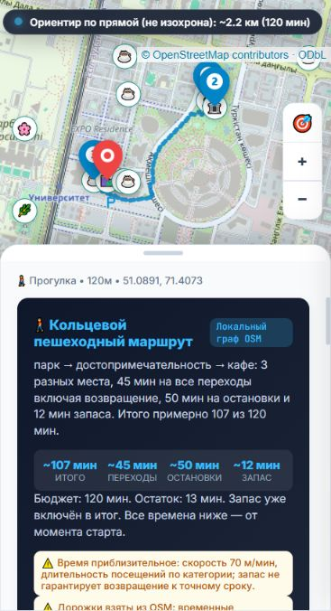

# Telegis — отчёт о готовности прототипа

Это отчёт предыдущего этапа интеграции. После него добавлены семейные, ночные и туристические сценарии: актуальные данные и оценки — в [новом отчёте](scenario-upgrade-report.md). Архив и презентация версии 1.3 отражают прежний датасет из 49 POI.

Проверка от 20 октября 2026 года, API 1.3.0. После интеграции интерфейса восстановлена работа единого приложения: рекомендации, мини-маршруты, карточки мест, демонстрационный режим и презентация. Найденные блокирующие ошибки исправлены. Оценка технического прототипа для прогулок и кофе в районе EXPO / Mega Silk Way — **9/10**. Это инженерная оценка по проверенным сценариям, а не прогноз баллов жюри.

## Что исправлено

- Восстановлены воспроизводимые POI и официальные факты. Неподтверждённые дубликаты удалены. Манифесты теперь проверяют SHA-256 исходного ответа, POI и стартовых точек; изменения часов или удобств при неизменных ID также отклоняются. Git сохраняет необходимые байты JSON на Windows.
- Интерфейс отправляет отдельные тела запросов для рекомендаций и маршрутов. Добавлены отсутствовавшие каталог `/api/pois` и сведения `/api/poi_ai_info`; оба используют тот же проверенный датасет.
- `preview_server.py` запускает основной FastAPI. Отдельной логики с выдуманными линиями и игнорированием ограничений больше нет. Репозиторий, `.env` и исходный Python-код не обслуживаются как веб-файлы.
- Неизвестные часы, розетки, доступность, телефоны и фотографии не подставляются. Нулевые показатели не заменяются рекламными числами. Состояние модели и fallback отображаются явно.
- Маршрут показывает причины, занятия, источники, предупреждения, время остановок, возврат и резерв. Предложенный бюджет 83 минуты выбирается точно; конфликт с лимитом в тексте не замалчивается.
- Исправлены устаревшие ответы при переключении режима, фильтра, тега и карточки; старт из карточки меняет реальные координаты формы. Удобства и адреса согласованы с каталогом.
- Сохранены цвета, карта, карточки и компоновка. На узком экране панель теперь прокручивается и автоматически показывает результат. Название приведено к Telegis.
- Устранена блокировка тайлов: документ передаёт внешнему серверу только origin, API сохраняет `no-referrer`. Атрибуция постоянно видна. Это соответствует [требованиям сервера тайлов OSM](https://operations.osmfoundation.org/policies/tiles/). При ошибке загрузки доступна локальная схема из 36 908 реальных сегментов сохранённого графа; она явно обозначена как схема дорожек.
- Mock использует 17 записанных ответов настоящего бэкенда только при точном совпадении параметров. Другие запросы получают объяснение, а не чужой маршрут.
- Презентация исправлена: PDF содержит 6 полноценных страниц; сценарий выступления рассчитан на 5–7 минут.

## Подтверждённые проверки

| Проверка | Результат |
|---|---|
| Полный pytest | 215/215 |
| Интеграционный прогон без модели | 24/24 |
| Интеграционный прогон работающего сервера, с разрешёнными вызовами модели | 24/24 |
| Совместимый preview на 8080, без платных положительных рекомендаций | 22/22 |
| Независимая матрица: 2 старта × 5 бюджетов × 4 варианта поиска | 40/40 |
| Согласованность каталога и подробных карточек | 49/49 |
| Проверки сценариев рекомендаций и новой фишки | 10/10 и 12/12 |
| JavaScript | Синтаксис и поведенческие VM-тесты проходят |
| Приватные файлы и обходы директорий | Проверенные URL возвращают 404 |
| PDF | 6 страниц визуально проверены |
| Чистый Git-архив | 9/9 контрольных сумм; запуск, 49 POI и маршрут 107 минут проверены после распаковки |

Эти группы частично пересекаются; их нельзя складывать в число уникальных тестов. VM-проверки охватывают payload, отмену и устаревшие ответы, карточки, неизвестные признаки, 83 минуты, конфликт текста, mock, ошибку сети, резервную карту и мобильную прокрутку.

Отдельная проверка архива выявила старую нормализацию переводов строк в четырёх файлах исходных данных и графа. Исправлены правила Git и сохранённые байты этих файлов; манифесты и исходные даты не менялись. Повторная проверка всех девяти SHA-256 прошла. Приложение из распакованного архива запускается без локального `.env`, отдаёт 49 POI и строит кольцевой маршрут на 107 минут. Секретный `.env` в архив не входит.

Реальные запросы OpenRouter отдельно подтвердили `mode=rag`: прогулка — 3,67 с, кафе — 4,70 с в зафиксированных прогонах. Время зависит от провайдера и нагрузки. Маршрут на 120 минут в отдельном HTTP-прогоне рассчитан примерно за 1,49 с.

Машиночитаемые результаты: [offline](integration-offline.json), [live HTTP](integration-live.json), [preview](integration-preview.json), [RAG прогулка](live-rag-walk.json), [RAG кафе](live-rag-cafe.json), [маршрут](live-itinerary.json), [проверки фишки](feature-verification.json).

## Что проверено в браузере

| Сценарий | Фактический результат |
|---|---|
| Прогулка от Mega на 60 минут | Два места с источниками и временем, включая возврат |
| Кофе на 30 минут | Drinkit, около 27 минут с посещением и возвратом |
| Тихое кафе с розеткой | Честный отказ: нужные свойства не подтверждены |
| Маршрут на 120 минут с кофе | Аллея мира и согласия → 25-ти летие Независимости → Drinkit → старт |
| Учёт времени этого маршрута | 45 минут переходов + 50 посещений + 12 резерва = 107; свободны 13 минут |
| Маршрут на 60 минут с кофе | Отказ и предложение 83 минут |
| Нажатие «Выбрать 83 мин» | Готовый маршрут: 44 + 30 + 9 = 83 минуты |
| «Начать прогулку отсюда» в карточке | Выбранная точка формы меняется на этот POI |
| Mock: прогулка 60 минут | Две карточки с явной маркировкой тестового примера |
| Mock: маршрут 90 минут с кофе | 85 минут, без подстановки 107-минутного примера |
| Настоящий сервер без модели | Рабочие рекомендации с явной отметкой локального подбора |
| Остановка тестового сервера | Сообщение об ошибке и возможность повторить запрос |
| Узкий экран 367 px | Карта загружается; панель и результаты доступны |

Точное местоположение пользователя для проверки не запрашивалось: использовались публичные стартовые точки датасета. Разрешение GPS в реальном устройстве и все браузеры/модели телефонов не проверялись.



## Данные и границы результата

В базе 49 POI и 2 стартовые точки. Есть 72 факта у 35 мест: 66 из OSM и 6 из трёх официальных источников. Часы указаны у 15 мест, контакты у 14; Wi-Fi подтверждён в источнике у 5. Подтверждённых розеток, тишины и доступной среды нет. NU Park исключён из маршрутов до подтверждения доступности. Граф содержит 30 829 узлов и 73 816 направленных рёбер.

Покрытие ограничено районом EXPO. Часы, цены, погода, временные перекрытия и входы в реальном времени не проверяются. Соединения координат POI с сетью приблизительны, до 120 м с каждого конца; резерв времени не гарантирует прибытие к точному сроку. Поиск использует лексическое ранжирование и ограниченный набор правил. Переведены элементы интерфейса, но тексты рекомендаций в основном русские. Источники могут устаревать; даты и ограничения показываются.

Бэкенд не сохраняет запросы и GPS и не передаёт исходный текст или координаты пользователя модели. Внешние тайлы и шрифты требуют сети; сервер карты видит IP и запрошенную область тайлов. Локальная схема использует уже собранные данные OSM и не скачивает растровые карты для офлайн-хранения.

## Оценка по критериям

| Критерий | Оценка | Основание и предел |
|---|---:|---|
| Релевантность | 9/10 | Проверенные прогулки и кофе; покрытие небольшое |
| Контекст и ограничения | 9/10 | Бюджет, категории, возврат, обязательные признаки; нет live-часов |
| Объяснения | 9/10 | Конкретные источники и занятия; у части мест мало фактов |
| UX | 9/10 | Карта, карточки, честные состояния, исправленная мобильная панель |
| Отличительная фишка | 9/10 | Маршрут с возвратом, резервом и работающим предложением бюджета |
| Этика и приватность | 9/10 | Нет фиктивных удобств, ключей во фронтенде или хранения GPS; внешние тайлы обозначены |
| Завершённость сдачи | 8/10 | Код, проверки и PDF готовы; запись и ссылка YouTube отсутствуют |

Для технической демонстрации результат готов в обозначенных пределах. Для полного комплекта сдачи остаётся записать видео по [сценарию](../presentation/demo-script.md) и добавить доступную ссылку YouTube. Публичное размещение с платным API требует отдельной защиты доступа и лимитов расходов.

## Как повторить

Из корня репозитория после установки зависимостей:

```powershell
python -m pytest -q
node tests/frontend_contract.cjs
python test_suite.py --offline
python -m uvicorn app.main:app --host 127.0.0.1 --port 8000 --no-access-log
```

Открыть `http://localhost:8000/`. В другом терминале: `python test_suite.py`; для разрешённой платной проверки — `python test_suite.py --live-llm`. Презентация доступна по `/presentation/slides.html` и `/presentation/slides.pdf`.
